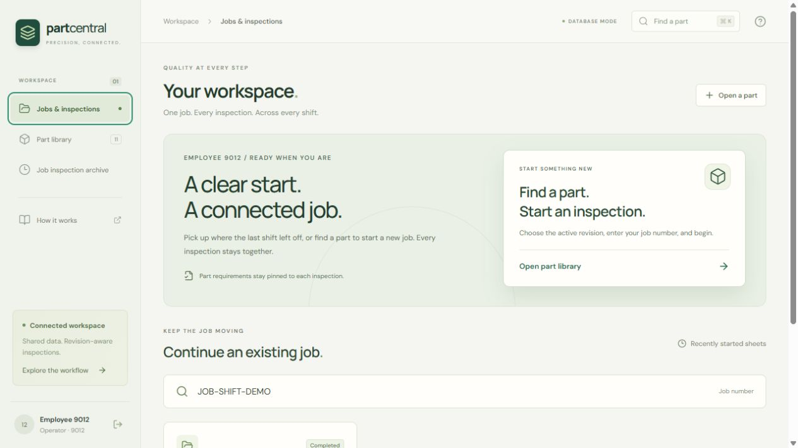
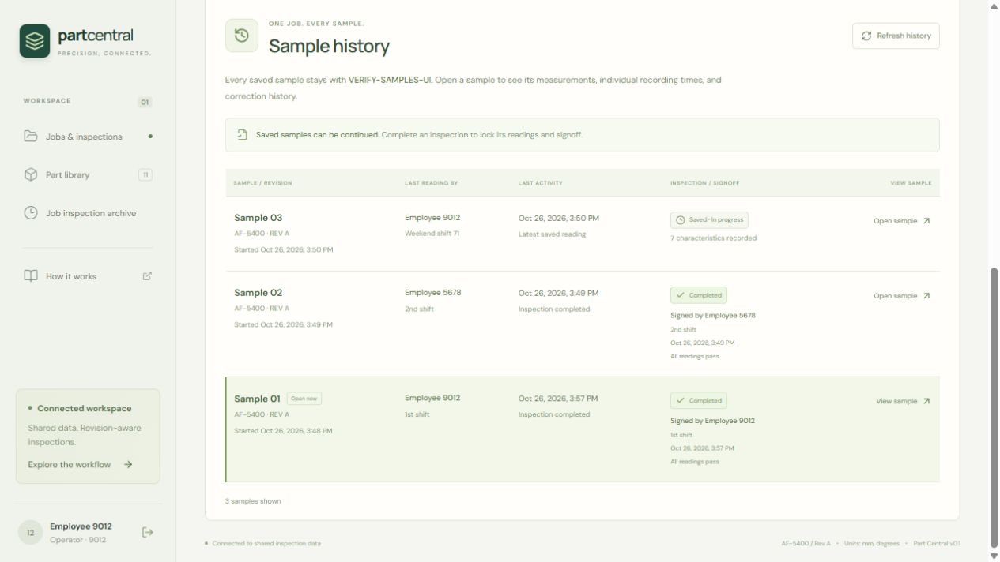
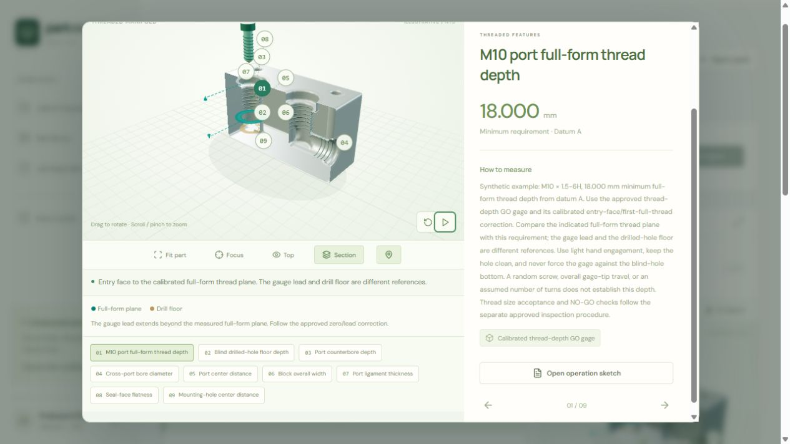

# Part Central

A shared machining inspection workbench that connects part requirements, job-number inspection sheets, and optional sketches, diagrams, and animated guidance.

[**Open the live demo**](https://clayton-klemm.github.io/part-central/) ·
[Verification](https://github.com/Clayton-Klemm/part-central/actions/workflows/ci.yml) ·
[Local setup](#try-it-locally) · [Contributing](CONTRIBUTING.md)

Explore the synthetic browser demo on GitHub Pages, or run the database-backed system on your own computer or on-premises server. The public demonstration stores each visitor's entries in their browser. Your local inspection database, uploaded references, credentials, and development tools are excluded from publication. Pages releases require a deliberate manual action.

The example library spans dog clutch gears, differential components, housings, shafts, flanges, bearing features, and threaded holes. Feature guides show measurement intent, including the distinction between full thread depth and drilled-hole depth. All parts, dimensions, and illustrations are synthetic.

For a quick demonstration, enter sample employee **1234**, open **Part library**, and select **DG-1042** or **MF-6100**. Explore a feature guide, start a demo job, choose a shift, and save a reading. No account or server is needed for the browser demo.





## Explore the workflow

1. Sign in with a four-digit employee number. The workspace opens without a selected part. Look up an existing job to continue, or open **Part library** / **Ctrl/Cmd + K** to select an active part revision and start a new job sheet. Lot/batch and sample remain separate identifiers.
2. Follow the written requirements. Open available sketches or diagrams, and use the animated helper when that part has a supported guide. Missing visual references do not block a sheet.
3. Enter readings, choose **1st (1)**, **2nd (2)**, or **Weekend (71)**, then select **Save readings** at the top or bottom of the sheet. Decimal inputs accept `.04` and `0.04`. Each event keeps the signed-in employee number, selected shift, and recording time. A correction retains the earlier reading and its original author. Another employee can continue a draft on a later shift.
4. After saving, choose **New sample inspection** to open a blank sheet under the same job and lot. Review the suggested sample label and choose a shift again. The new sample uses the active part revision; the earlier sample retains its readings and current status. Starting another sample does not complete the earlier one.
5. Open **Sample history** to review each sample's progress, authors, shifts, and times, or reopen a saved sheet for its readings. The history distinguishes the latest reading's author/shift from a completed sheet's signer/shift and loads additional samples in pages.
6. Complete every characteristic and choose **Complete inspection** when that sample should be locked with its completion signer and shift. Export the current sheet as CSV or its audit trail as JSON.

Sample labels are editable display identifiers and may repeat for a physical
piece or reinspection; each inspection sheet has its own unique run ID. A
suggested next label considers the latest 50 summaries on that job. It is a
convenience, not a global uniqueness check or server-reserved number.

[View the new sample dialog](docs/new-sample-inspection.jpg) and
[verified multi-shift workflow](docs/VERIFICATION.md#sample-workflow-and-peer-refresh-browser-verification).

For the animated gear example, open `DG-1042`, select **Ramp start height**, and expand its feature helper. The supplied library includes fuller synthetic sketches and guides; the same workflow still supports a new part with written requirements alone.

The differential, bearing cap, flange, shaft, manifold, housing, and ring examples also have interactive 3D guides. Drag to rotate, zoom, select numbered feature markers, and use **Fit part**, **Focus**, **Top**, and **Section** to study the selected measurement. Pause/replay controls and a **2D diagram** option make the depth planes, surfaces, and contact locations easier to inspect. Models are illustrative and not to scale. Nominal values stay in the inspection sheet and information panel, keeping animation panes clear. See [example coverage and guide controls](docs/EXAMPLE_PARTS.md).



[View the differential close-up](docs/interactive-differential-3d.jpg) · [View an interactive hover preview](docs/interactive-hover-guide.jpg)

| Part example | Inspection coverage |
| --- | --- |
| `DF-5200` Differential carrier | Bearing/pilot bores, cross-pin bore, shoulder span, bolt circle, full-form thread depth, and window ligament |
| `BC-5300` Split bearing cap | Assembled bore, hole spacing, crown/wall height, retaining thread depth, drilled-hole floor, and split-face flatness |
| `AF-5400` Axle companion flange | Locating bore, bolt circle, thread engagement depth, counterbore, thickness, and runout |
| `SS-5500` Stepped differential shaft | Bearing journal, shoulders, overall length, keyway, axial thread depth, and journal runout |
| `MF-6100` Hydraulic manifold | Blind port thread depth versus drilled floor depth, counterbore, cross-port bore, spacing, wall ligament, and seal-face flatness |
| `PH-7200` Pump bearing housing | Bearing pocket, spigot, mounting flange, cavity wall, cover threads/counterbores, spacing, and flatness |

The manifold also includes inactive released and draft revision examples for the administrator workflow. Depth examples use explicit minimum-only limits where appropriate; a full-thread requirement is not interchangeable with drill-point depth or uncorrected gauge travel.

## Database guarantees and performance evidence

The design separates engineering definitions from job samples and immutable
measurement events. Keys, foreign keys, decimal checks, partial uniqueness,
and transaction locks protect different invariants. The [design proof](docs/DATABASE_PROOF.md)
states its assumptions, lossless joins, functional dependencies, and deliberate
exceptions to normalization. It does not claim one schema is fastest for every workload.

For example, with `T` samples, `F` features, `R` bytes of requirement text and
`M` bytes per reading, avoiding repeated definitions saves:

$$
TF(R+M)-(FR+TFM)=(T-1)FR.
$$

At `T=10,000`, `F=20`, `R=256 B`, `M=64 B`, that is **48.82 MiB** less repeated
text in this simplified model, before keys, indexes and compression. A partial
unique index enforces at most one active revision per part, and the configured
API connection bound is `1 × 4 × (5 + 5) = 40`.


The retained authenticated database gate for the unchanged backend on schema **0010** completed **300
sheets across 100 jobs with 100 concurrent clients**, **4,200 measured requests**,
and **zero unexpected errors**. Clients selected **1, 2, and 71 (weekend)**
across three samples on each job; every employee/shift stamp and exact
job-history response was checked. The test used an isolated local database
and reference-file clone, keeping the operator's server available.

| Client-observed latency | p50 | p95 | p99 |
| --- | --- | --- | --- |
| All requests | 131.95 ms | 275.60 ms | 418.09 ms |
| Save a reading | 130.80 ms | 249.61 ms | 359.46 ms |
| Exact job history | 115.70 ms | 238.67 ms | 267.52 ms |
| Reopen a sheet | 84.95 ms | 208.95 ms | 305.31 ms |


This was a **7.198-second local synthetic burst**, with sign-ins outside the
clock and session verification inside it. It is not an endurance test or
production SLA. [Raw report](docs/load-test-shifts-results.json),
[hardware, dataset and limitations](docs/PERFORMANCE.md),
[integrity and query plans](docs/database-audit-after.json).

Every database design change must pass the full regression suite, migration
preservation, live PostgreSQL invalid-write/race checks, integrity audits and
the 100-client workload. The chosen local gate requires **zero unexpected
errors and overall/save p95 ≤ 1,000 ms**:

```powershell
./scripts/verify_database.ps1
```

CI runs its PostgreSQL gate on every push/pull request and retains raw evidence.
The [database work contract](api/AGENTS.md) keeps this requirement explicit for
future edits. [Reproduce the math and Manim GIFs](docs/EVIDENCE_RENDERING.md).

## Try it locally

Requires Node.js 24 or later.

```sh
npm ci
npm run dev
```

Open the local address printed by Vite. This browser demo runs without an API server or database. Sample parts are synthetic, and inspection progress is stored in this browser. Durable employee sessions and administrator catalog management use the Docker shared-server mode below. A static browser demonstration is not an access-control boundary.

## Run the database-backed system

Requires Docker Desktop or Docker Engine with Compose.

1. Copy `.env.example` to `.env` and replace `POSTGRES_PASSWORD` with a strong URL-safe password. To enable administrator reference uploads, also set a separate random `ADMIN_TOKEN` of at least 32 characters. Leave it empty to disable admin writes.
2. Start the stack:

```sh
docker compose up --build -d
```

Open [Part Central](http://127.0.0.1:8080) and [interactive API documentation](http://127.0.0.1:8080/api/docs). The stack contains the web app, four configurable API worker processes, and PostgreSQL 17. Migrations and sample seeding run before the workers start. PostgreSQL and uploaded reference files have separate persistent volumes.

```sh
docker compose logs -f api
docker compose down
```

Stopping the stack preserves its database. `docker compose down -v` deletes the demo database and its inspection history.

The web port binds to this machine only by default. `HOST_BIND` and `WEB_PORT` can select a server interface and port during deployment. Operators identify themselves with four digits; administrator `0000` also requires the server credential. This local-pilot identification does not verify that a person owns a claimed employee number. Add TLS and verified organizational identity before broad production access.

## Reference administration and gradual adoption

Inspection requirements, operation sketches, diagrams, and animations are separate modules. A part can begin with approved requirements and written instructions alone. Add a basic sketch now and diagrams or validated animation later, without stopping job inspections.

In shared-server mode, sign in as employee `0000` with the server's administrator credential and open **Part management**. Create a part, prepare its draft requirements, choose a visual family, add optional references, review, and release it. A released revision can be made active or inactive; normal lookup exposes at most one active revision per part. Changes to released requirements go into a new draft revision instead of rewriting old sheets.

Upload PDF, PNG, or JPEG references and publish a new documentation version. Files are limited to 10 MiB. Older sheets retain their original reference snapshot; a new upload does not rewrite a historical inspection. See [employee access and the part/revision pipeline](docs/AUTH_AND_REVISIONS.md) for the complete workflow and its pilot limitations.

## Multiple workstations

The first capacity target is 100 or more connected computers. The starter uses bounded database pools, multiple API workers, bounded catalog/history queries, summary lists, compressed assets, and browser-rendered animation. These are starting controls, not a capacity guarantee.

The repeatable workload creates three complete synthetic inspections per client under that client's job number:

```powershell
api/.venv/Scripts/python.exe scripts/load_test.py --users 100 --iterations 3
```

It reports request errors, p50/p95/p99 latency, throughput, and scenario limits, retaining labeled synthetic jobs for review. See [performance and rollout](docs/PERFORMANCE.md). Test again with representative histories, assets, hardware, and network before deployment.

The current shift-aware workload and its regression budget are summarized above. The [raw report](docs/load-test-shifts-results.json) includes endpoint results, employee/shift assertions, configuration, data size, and exclusions. Earlier authenticated and pre-authentication reports remain labeled baselines in [performance notes](docs/PERFORMANCE.md).

## Put the tech demo on GitHub

The [publishing guide](docs/PUBLISHING.md) covers initial setup and subsequent
releases. Pushing to `main` runs verification; publishing requires manually
running **Publish browser demo** with its explicit publication input enabled.

The included workflow builds a static demo with the repository's base path. Visitors can explore parts, available references, animation, and inspection entry without paid infrastructure. Each visitor's records stay in their own browser; GitHub Pages does not run PostgreSQL or admin uploads. Docker demonstrates centralized storage and job-number searches across devices.

The workflow reads the configured Pages base path, including user sites and
custom domains. No repository-specific asset-path edit is required.

## How the data stays connected

- A part number identifies the part; a revision identifies the exact engineering definition.
- An operator sees only the active revision. Administrators prepare drafts, release reviewed requirements, and select the active revision without changing historical sheets.
- Each operation belongs to a revision. Its inspection characteristics link to sketch callouts and animation keys.
- A job groups sheets without replacing the part, lot, or sample identifiers. Runs pin their engineering revision, operation, and reference snapshot; later edits do not silently change historical sheets.
- The API evaluates limits using exact decimal values. Re-measurements append history; completion uses the latest reading for each characteristic.
- A run can be completed only after every characteristic has a measurement. API rules and database triggers protect completed records, append-only history, and released engineering definitions.

See [the architecture and database model](docs/ARCHITECTURE.md) for the relationships, boundaries, and production next steps.

## Development and checks

See [CONTRIBUTING.md](CONTRIBUTING.md) for repository hygiene, local tooling,
synthetic examples, and the database change gate.

```sh
npm run test
npm run build
```

Backend checks use Python 3.13 or later:

```sh
cd api
python -m venv .venv
# Activate .venv using your shell's command.
python -m pip install -r requirements.txt
python -m pytest tests -q
```

CI verifies the frontend, backend behavior, and PostgreSQL migrations with repeatable seeding. The database-backed web build uses `VITE_DATA_MODE=api`; the default is `demo`. API requests go through the same origin under `/api/`.

For the live PostgreSQL guard and concurrency checks, run `docker compose exec -T api python tests/postgres_smoke.py`. This adds a labeled synthetic verification run and retains it for review. The latest completed local checks are recorded in [verification notes](docs/VERIFICATION.md).

## Scope

This is a technical demonstration built with React, TypeScript, Three.js, FastAPI, SQLAlchemy, Alembic, and PostgreSQL. The procedural gear and sketches explain measurement intent; they are illustrative geometry, not certified CAD or controlled engineering drawings. All sample dimensions and parts are fictitious.

Production use needs verified employee identity, approval workflows, calibrated-gauge traceability, approved CAD/drawings, backups, and validated inspection procedures. Employee numbers and server-protected administrator sessions are implemented for the local pilot; enterprise authentication and process validation remain future work.

MIT licensed. See [LICENSE](LICENSE).

