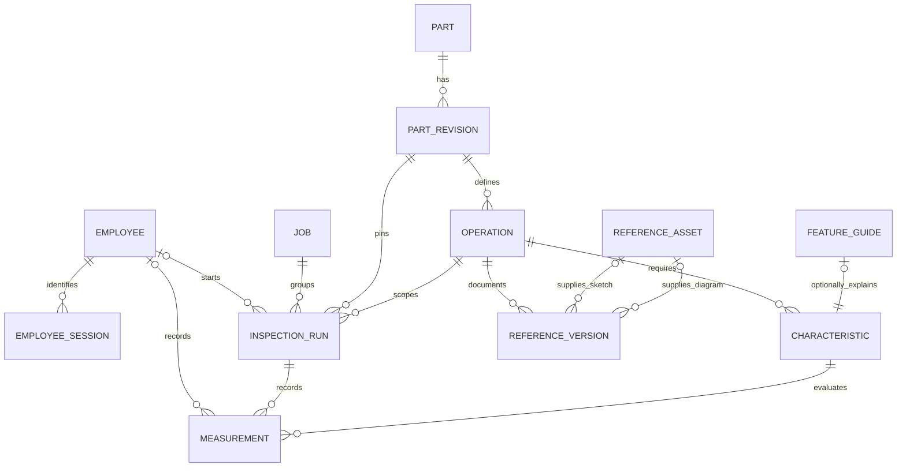

# Architecture and data design

Part Central has a central database mode for the shop floor and a separate browser demo for GitHub Pages. Workstations connect through a browser; they do not maintain copies of the shared database.

| Mode | Catalog | Inspection records | Hosting |
| --- | --- | --- | --- |
| Browser demo | Bundled sample definitions | This browser's storage | Vite or GitHub Pages |
| Shared server | PostgreSQL | PostgreSQL through FastAPI | Docker Compose |

An API error stays visible. The application must not silently replace a failed shared save with a browser-only record. Browser demo records do not synchronize into PostgreSQL.

## Core relationships

A part number is a unique business key. Stable IDs carry relationships. Material and finish belong to the engineering revision, and an operation's requirements belong to that exact revision. Row labels and positions help display a sheet, but a characteristic ID identifies what was measured.

Engineering revisions have separate draft/released status and an active flag. Operators discover only the active released revision. Administrators can prepare multiple drafts or retain inactive released definitions; a partial unique index permits at most one active revision per part. Activation locks the part and changes flags transactionally. Existing run IDs remain linked to their original revision.

A job number groups inspection sheets. It is separate from a part number, lot/batch, and sample identifier: one job can have multiple parts and samples. New sheets require a job number. Existing demo runs receive explicit legacy job labels during migration; historical run IDs and events are preserved.

## Inspection lifecycle

1. Identify the operator with a four-digit employee number. The job workspace opens without selecting a part. Search an existing job to continue, or select a part and its active released requirements to prepare a new sheet.
2. Enter the job number and sample, with a lot/batch when applicable, then start the sheet. The server derives employee identity from the session instead of trusting an editable inspector field.
3. The run pins its engineering revision, operation, and reference bundle available at that moment.
4. Enter readings, choose shift 1, 2, or 71 (weekend), and select **Save readings**. Each changed reading appends against its characteristic ID with the authenticated employee number, selected shift, and server timestamp. The server verifies membership and evaluates exact decimal limits. A save sends readings sequentially with the current event sequence; if a request fails, previously acknowledged events remain saved and the remaining inputs stay unsaved. Historical shift-3 readings remain unchanged and readable; new writes use the current three codes.
5. Corrections append later events; earlier readings remain in the audit trail.
6. Completion requires a saved reading for every characteristic and locks the run with its own authenticated signer and selected shift. A failed run can still be completed for review and disposition.
7. Search by job number to resume an open sheet or retrieve a completed sheet. A job's inspection tabs show samples, revisions, authors/shifts, and times across days. History lists bounded summaries; full readings load only when opened. **New inspection** prepares another sample on the currently active part revision; earlier sheets retain their pinned revision.

Completion finalizes the record; a physical-part release or engineering approval needs a separate workflow. Reopening a run retrieves its pinned engineering revision instead of substituting the newest revision. Its stored reference snapshot prevents later diagram changes from altering the meaning of a historical sheet.

Shift is an event fact, not a mutable attribute of the whole job or employee.
Changing shifts cannot relabel earlier readings. Legacy shifts and completion
signers remain unknown when they were not captured. The UI protects unsaved
inputs when changing sheets and disables export until edits are saved or
discarded. A workstation conflict requires reloading the saved sheet before
reapplying an intended correction.

## Optional information and gradual adoption

Inspection requirements are the required module. Visual aids are independent optional modules.

| Available information | Operator experience |
| --- | --- |
| Requirements and written instructions | Start, measure, save, and complete normally |
| Basic operation sketch | Open the sketch alongside the requirements |
| Sketch plus diagram | Use both references when present |
| Validated feature guide | Open an animation for the supported characteristic |

A missing sketch, diagram, or animation is an explicit availability state. It must not remove a characteristic, prevent a sheet from being started, or cause an unrelated gear model to appear. Optional guide relationships use outer joins so incomplete documentation cannot hide inspection rows.

This permits rollout one part family at a time while paper sketches or existing systems continue to be used. Approved requirements and written procedures determine the measurement; visual documentation can improve later. Visual families select supported illustrative renderers for gears, differentials, housings, flanges, shafts, rings, and threaded features. No unrelated gear fallback is used for unsupported parts.

## Employee sessions and controlled revisions

Normal operator sign-in accepts an exact four-digit number and enrolls it on this trusted local pilot. This records the claimed employee identity rather than proving it. `0000` is reserved for the administrator account and additionally requires the server credential. Server-verified roles protect catalog and reference writes.

Sessions are stored as hashed random tokens with eight-hour expiry and revocation on logout. The browser receives an HttpOnly, SameSite=Strict cookie; same-origin validation protects browser mutations. Run and measurement employee numbers are stamped by the server. Earlier records keep a nullable legacy identity instead of acquiring a guessed operator. Named verified employees, stronger authentication, and electronic signatures still require a production identity process.

Administrators create a draft part/revision, define operation requirements and visual family, add optional references, review, release, and activate. A release requires usable written inspection requirements; visual files remain optional. Released definitions cannot be edited: later engineering changes are cloned into a new draft revision. Normal lookup never chooses the newest timestamp as a substitute for an explicitly active revision. See [employee access and the revision pipeline](AUTH_AND_REVISIONS.md).

## Administrator references

Administrators upload PDF, PNG, or JPEG references and publish a new documentation version for an operation. Sketches and diagrams can be added independently or left absent. Immutable assets have checksums and belong to a specific operation. The server validates signatures, bounds uploads to 10 MiB, and never executes uploaded HTML or SVG.

Publishing uses the version the administrator opened as a precondition. If another administrator has already published, the stale update is rejected. Previous versions and files remain available to historical snapshots.

The demo protects admin writes with the server-verified `0000` session or a valid administrator bearer credential for local service clients. An empty `ADMIN_TOKEN` disables administrator sign-in and reference writes. Operators do not need that secret. This is a limited local-pilot identity process; verified employee ownership and formal approvals remain production work. Never embed the credential in a frontend build or commit it to Git.

## Integrity choices

**Exact values.** Authoritative specifications and measurements use fixed-precision numerics and Python decimals. Limits are inclusive. A characteristic explicitly chooses bilateral, minimum-only, or maximum-only limits, so a minimum thread depth does not rely on an invented large upper tolerance. Units and angular versus linear characteristics are explicit. API mode stores the server's evaluation.

**Relationships.** Foreign keys connect requirements, operations, revisions, jobs, runs, and readings. Unique and check constraints reject duplicate identifiers, invalid tolerance offsets, and incompatible entities. Cross-operation readings are rejected by API and database safeguards.

**Immutable definitions and events.** Released engineering definitions, measurement events, and completed records are protected. Reference changes create new versions rather than rewriting released requirements. Direct database administrators remain privileged; production audit controls also need least-privilege accounts and controlled maintenance.

**Scoped concurrency.** PostgreSQL locks the individual run while appending or completing it. Different runs can progress concurrently. Browser writes include the expected event sequence, rejecting an unseen correction from another workstation rather than silently finalizing stale data. Administrator activation locks the part; reference publication checks the expected reference version. Database pools are bounded independently of the number of browsers.

**Migrations.** Alembic owns forward migrations and preserves inspections. The single API container runs migrations and seeding before launching worker processes. Later replication across containers should use a separate deployment migration job.

**Fixtures.** `data/demo.json` seeds the catalog and browser demo. PostgreSQL and immutable reference files own shared records after deployment; the fixture is not their ongoing source of truth.

## Many connected computers

The starting Docker configuration runs four API processes. Each has five retained database connections plus five overflow connections: at most 40 API database connections, leaving room under PostgreSQL's default 100-connection limit. Multiply the budget when adding workers or API replicas. [SQLAlchemy pooling](https://docs.sqlalchemy.org/en/20/core/pooling.html), [FastAPI workers](https://fastapi.tiangolo.com/deployment/server-workers/).

Catalog and job history use bounded queries and summary payloads. Full measurement events load for a selected sheet. Nginx compresses applicable responses and reuses API connections. Animation uses workstation graphics rather than server-rendered video.

These choices control avoidable work; they do not guarantee latency for arbitrary user counts. See [performance and deployment](PERFORMANCE.md) for the repeatable 100-client scenario and its limits.

## Deployment and growth

Only the web service binds a host port, defaulting to loopback. PostgreSQL and the API use the internal Compose network. The database and uploaded files have separate persistent volumes; both require backup and restore plans. Ignored environment files supply secrets.

GitHub Pages serves only the browser demo. The Docker server is the path for multiple shop computers.

| Area | Production extension |
| --- | --- |
| Identity | Verified employee ownership, stronger authentication, and approval/electronic-signature records around the implemented local employee sessions |
| Existing systems | Map job/work-order IDs and document references through import or integration adapters |
| Sampling | Store every required dog, hole, or tooth reading and enforce the approved sampling plan |
| Metrology | Gauge IDs, calibration, resolution, and method versions |
| Assets | Approval state, object-storage versions, retention, and approved CAD anchors |
| Operations | TLS, managed secrets, least-privilege accounts, monitoring, backups, and restore drills |
| Larger datasets | Representative tests, query-plan review, cursor pagination, and archival policies |

Illustrative geometry cannot replace approved engineering drawings or inspection procedures.
