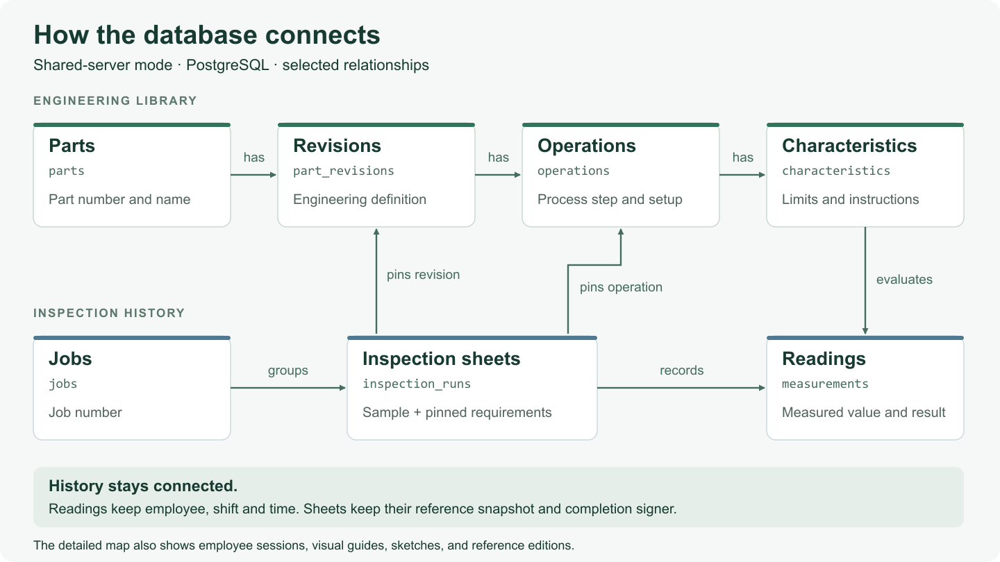
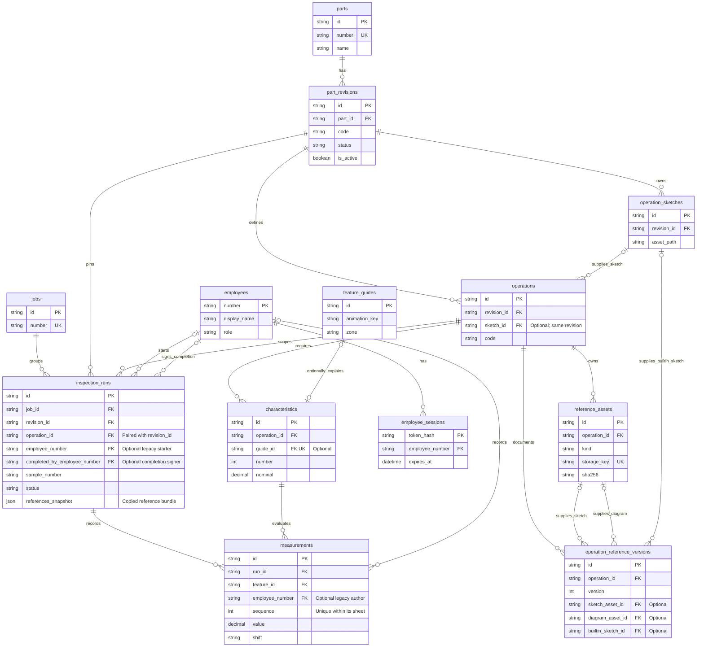

# How the database connects

The shared-server version keeps its records in PostgreSQL. Browsers use the API
to read requirements and save inspections into that shared database. The GitHub
Pages demo is separate: its sample catalog is bundled with the app and its
inspection entries stay in each visitor's browser.

[Open the vector diagram](assets/database-overview.svg).

## Follow one inspection

1. A **part** has engineering **revisions**. Each revision defines its machining
   **operations**, and each operation has **characteristics** to inspect.
2. A **job** groups its sample **inspection sheets** (`inspection_runs`). Each
   sheet pins the exact revision and operation it uses.
3. A **reading** (`measurements`) connects a sheet to one characteristic. It
   records the value, result, time, employee, and shift. A correction adds
   another reading, preserving the earlier event.
4. Optional sketches, diagrams, and feature guides explain the requirements.
   A sheet retains a copy of its reference bundle when it starts, so later
   documentation releases do not rewrite that sheet's references.

Released requirements, earlier reference editions, and measurement events are
protected from rewriting. Completing a sheet locks it with its completion
employee and shift. Historical authors or shifts that were never recorded
remain unknown.

## Table relationships

This map shows the 13 application tables and selected fields. `PK` identifies a
row; `FK` connects it to another table. A circle means optional, a single bar
means one, and a fork means many. Migration bookkeeping is omitted.

The operation/revision pair on a sheet is enforced together. An operation's
built-in sketch must also belong to that operation's revision. Uploaded assets
and published reference editions are checked against their owning operation.
The optional guide is unique to a characteristic.

`references_snapshot` is a JSON copy, not a foreign key to an edition. The map
therefore does not draw a relational link from a sheet to a reference edition.
Reference file bytes live in a separate persistent volume; `reference_assets`
keeps their metadata and checksum. Sample labels can repeat; the sheet's `id`
is its unique identity.

For implementation details, see the [architecture](ARCHITECTURE.md),
[engineering design notes](DATABASE_PROOF.md), and
[verification evidence](VERIFICATION.md).
