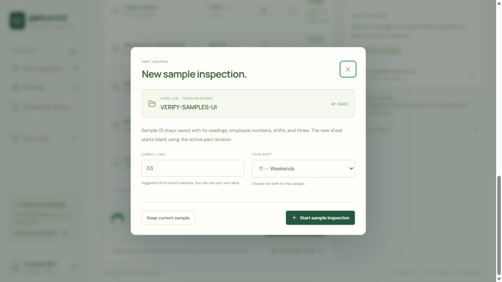
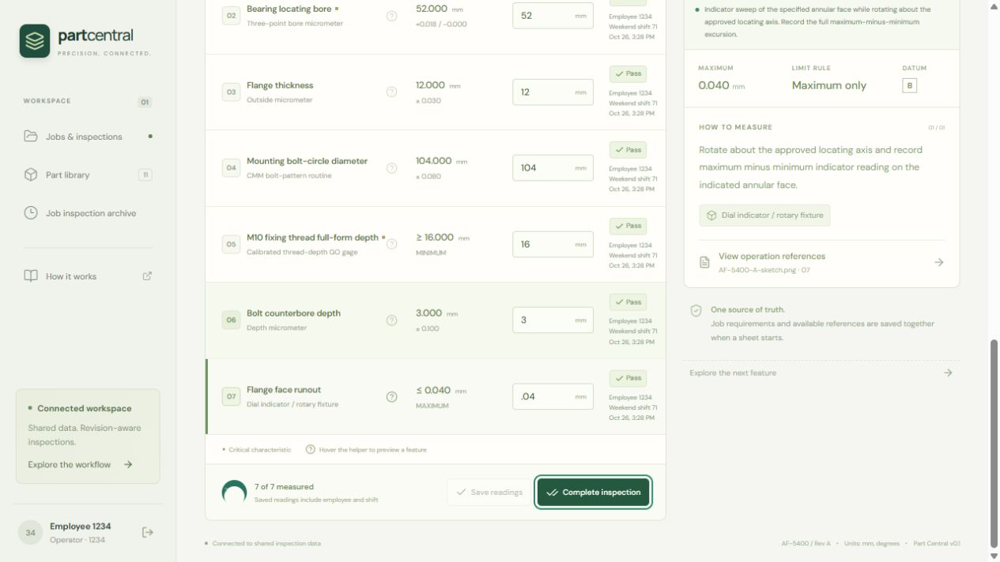
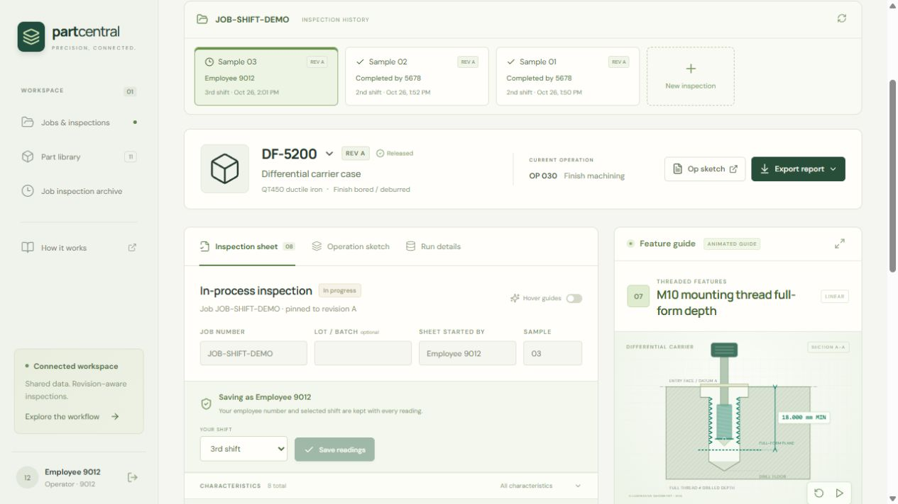
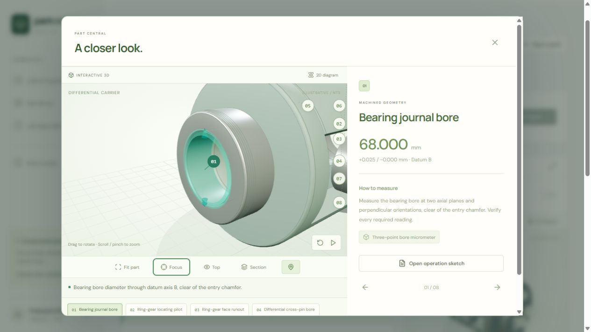
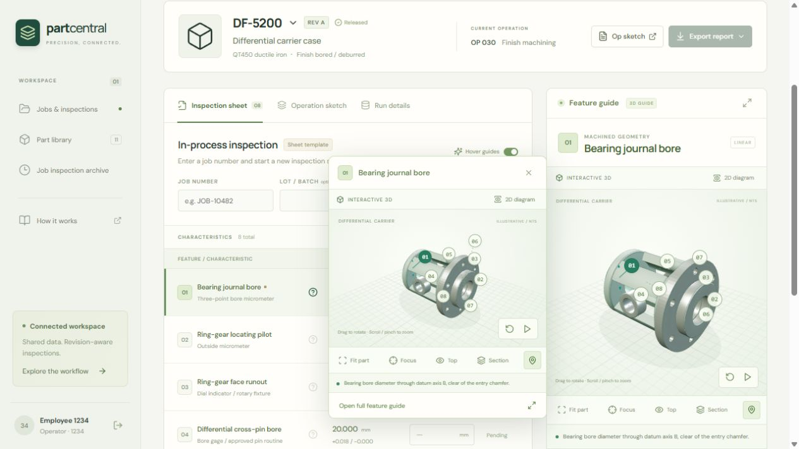

# Current verification

The database and workflow evidence below was verified locally on October 26,
2026 against **0010_weekend_shift**. At that time, no GitHub repository or
public deployment had been created. These historical results describe the local
database-backed system; they are not a benchmark of the GitHub Pages demo.

| Check | Current result |
| --- | --- |
| Frontend tests | **82 passed**; includes next-sample labels, required fresh shift selection, paged/refreshed sample history, reading/completion provenance, leading-decimal inputs, geometry, exact limits, and persistence; [raw results](frontend-sample-tests.json) |
| Backend tests | **146 passed** at the unchanged backend's schema-0010 gate, in 172.74 seconds using Python 3.13.17 in an isolated local no-network Docker container; [raw final output](backend-0010-test-results.txt) |
| Latest suite coverage | **228 passing tests**: 82 current frontend + 146 at the unchanged backend's last gate |
| Production build | TypeScript/Vite and local Docker build passed |
| Migration preservation | Both isolated and operator-stack 0009→0010 upgrades retained identical whole-set hashes for **8,147 events, 1,024 sheets, 26 assets, and 21 reference editions**; separate per-row protection also passed |
| Shift history | Current writes accept **1, 2, 71**; historical **3** and unknown NULL remain unchanged; completed signoffs and earlier event authors remain protected |
| Schema agreement | Both local PostgreSQL stacks reached Alembic head 0010; `alembic check` reported no new operations |
| Live inspection guards | Idempotent seed, decimal boundaries, append-only/released/completed guards, four serialized saves, stale conflicts, completion-versus-save race passed |
| Shift handoff | Original employee/shift events retained; shift-1 versus shift-71 same-sequence saves produced one 201 and one 409; direct writes accepted 71 and rejected new 3/missing/invalid attribution; completion signer and shift remained immutable |
| Live reference/lifecycle guards | Administrator upload/checksum, immutable editions/assets, stale publication, historical snapshot, draft/release/activation/deactivation and one-sided limits passed |
| Native sketches | All eight families passed exact selected-sketch/operation/revision/path ownership, opaque identifier, cross-ownership, sequential-edition and immutability probes; fixture writes rolled back |
| Unchanged backend stress gate | **100 clients, 300 sheets, 4,200 requests, zero unexpected errors** on the idle local clone; shifts 1/2/71; overall p95 **275.60 ms**, save p95 **249.61 ms**, exact history p95 **238.67 ms** |
| Integrity after load | All **11 invariants: zero violations**; raw keys/indexes, sizes and representative EXPLAIN plans retained |
| Mathematical examples | Functional-dependency closure, three lossless joins, exact decimals, storage arithmetic and serialized stale-save model passed; [raw results](design-proof-results.json) |
| Preservation helper | Five self-tests accept legitimate appends/completions and reject event/signoff/pinned-fact tampering or deletion; [raw results](preservation-checker-tests.json) |
| Evidence GIFs | Two actual Manim scenes, generated locally from labeled assumptions and successful raw report; palette optimization, source/output hashes and visual inspection completed |
| Completed example library | All 11 active parts / 82 characteristics have guides, sketches and supporting diagrams; 13 revision reference bundles verified; repeat import created no extra editions |
| Final operator-stack audit | All 11 invariants reported zero violations at **1,024 retained sheets / 8,147 events**; no verification jobs were added there; [final read-only report](database-audit-final.json) |
| Change gate | Local PowerShell gate syntax and CI YAML validated; every push/PR runs PostgreSQL migration, guards/races, audit and 100-client workload; GitHub execution remains pending a user-configured remote |

The [raw report](load-test-shifts-results.json) states hardware, data size,
scenario, sign-in exclusions and the chosen 1,000 ms p95 regression budget.
The subsequent sample-workflow update changes the frontend only and uses the
existing start-sheet and paged summary operations. It changes no database
models, migrations, API contracts, query definitions, or transaction behavior.
Sample labels remain editable display identifiers; run IDs identify sheets.
Suggestions inspect the latest 50 job summaries and do not allocate or enforce
globally unique labels. No functional dependency or constraint changed.
The schema-0010 database gate and its original Manim report remain unchanged;
they are retained backend evidence rather than a new benchmark of that UI.
The benchmark is a 7.198-second synthetic local request burst, not an endurance
test, production SLA, or proof of universal optimality. The [current audit](database-audit-after.json)
and [formal design rationale](DATABASE_PROOF.md) state their separate scopes.

The before/after migration fingerprints contain hashes rather than row values:
[0008 before](migration-0008-before-fingerprint.json), [0008 after](migration-0008-after-fingerprint.json),
[0009 before](migration-0009-before-fingerprint.json), [0009 after](migration-0009-after-fingerprint.json),
[0010 isolated before](migration-0010-verification-before-fingerprint.json),
[0010 isolated after](migration-0010-verification-after-fingerprint.json),
[0010 operator before](migration-0010-before-fingerprint.json),
[0010 operator after](migration-0010-after-fingerprint.json).
The 0008 reports cover original facts; 0009 additionally covers existing shift,
completion attribution, immutable asset metadata and reference editions.
The 0010 [per-row comparison](migration-0010-preservation.json) additionally
protects original draft-sheet facts and already-completed signoffs while
explicitly allowing counted legitimate new appends; there were none during
this operator-stack comparison.

The full gate's PostgreSQL and workload checks ran on an idle local clone at
`127.0.0.1:8081`, including a local reference-file copy. All 27 copied/test
assets passed [size/checksum verification](verification-clone-assets.json).
Five smoke suites retain their [raw output](postgres-0010-smoke-results.json).
Pre/post-load audits each found zero violations across 11 invariants. Counts
grew from 1,029 sheets / 8,187 events to 1,329 / 10,587. The clone containers
were stopped afterward; their volumes and labeled jobs remain for review.
The operator's separate `127.0.0.1:8080` server remained available and received
its schema upgrade only after the clone's complete gate passed.

The [initial backend attempt](backend-0010-initial-test-attempt.txt) had one
clock-dependent ordering assertion failure and 144 passes. Its isolated
rerun passed; the fixture now supplies controlled increasing timestamps and
an added test covers equal-timestamp ID ordering and pagination. Runtime
ordering and persistence code were unchanged. The complete 146-test rerun
passed; no correctness check or latency budget was relaxed.

Live tests retain clearly labeled synthetic jobs and editions. Invalid SQL
and native-sketch fixture probes use explicit rollback; no database reset or
history deletion was used. Earlier 130-test/1,400-request rounds are preserved
as [historical verification notes](VERIFICATION_BASELINES.md) and labeled
baselines in [performance notes](PERFORMANCE.md).

## Sample workflow and peer-refresh browser verification

The final frozen web build passed **82 frontend tests** and its production
TypeScript/Vite/Docker build. Browser verification used only the isolated local
clone and the labeled job `VERIFY-SAMPLES-UI`:

- Employee **1234 / shift 1** saved all seven readings on sample **01**.
- **New sample inspection** required a fresh shift choice and opened blank
  sample **02**. Employee **5678 / shift 2** saved all seven readings and
  explicitly completed that sample. Sample 01 remained saved in progress.
- Starting from older sample 01 suggested **03**, avoiding the recent label
  02. Employee **9012 / weekend 71** saved all seven readings on blank sample
  03; it remained in progress.
- With the primary tab holding sample 01's earlier history, a second browser
  tab acting as another workstation corrected feature 07 as **9012 / shift 1** from **0.04** to
  **0.035** and completed sample 01. **Refresh** updated both Sample history
  and the job's top sample strip with the new signer, shift, and completed
  status. Opening sample 01 loaded the immutable completed sheet; Run details
  retained its original **1234 / shift 1 / 0.04** event and the later
  **9012 / shift 1 / 0.035** correction, eight events total.

The two tabs shared the same authenticated employee-9012 session cookie;
this browser check did not simulate independent workstation sessions.
Sample 02 retained its **5678 / shift 2** completion and sample 03 retained
its **9012 / weekend 71** draft. Both tab consoles reported zero errors.
The [browser check record](sample-workflow-browser-checks.json) identifies the
frozen build and observed results. The clone containers were stopped after
verification; their database/reference volumes and synthetic records remain
local. These checks changed no inspection records on the operator stack.
The final operator-stack web build opened a blank job workspace after sign-in
and showed **Current sample** / **Sample history** on an explicitly selected
part template. That read-only check started no sheet, saved no readings, and
reported zero console errors. Its API/database containers were not rebuilt
or recreated; the sole published application port remains `127.0.0.1:8080`.

## Decimal entry and weekend browser verification

On the isolated clone, employee 1234 created the labeled job
`VERIFY-DECIMAL-71-UI`. The bottom **Save readings** action accepted `.04` for
AF-5400 feature 07, persisted exact `0.04`, and showed **Pass** at the inclusive
maximum. All seven readings saved, then **Complete inspection** locked the
sheet with weekend shift `71`. The selector offered only `1`, `2`, and `71`;
an incomplete `.` displayed inline format feedback. Browser console errors
were zero. The operator stack's updated web build also opened a blank
job-first workspace after sign-in; that check changed no inspection records.

## Earlier browser workflow

The sections below preserve earlier visual/workflow checks. Their historical
test totals and shift-3 examples predate the current gate above.

The local browser check verified a blank job-first workspace after sign-in,
operator 1234 saving shift-1 readings, operator 5678 resuming the same job on
shift 2 and correcting a reading, retention of both authors/shifts in the
sheet audit, completion, and creating another inspection tab under the same
job. Saved sheets retain their original engineering revision and references.

Final browser checks also verified employee 9012 starting sample 03 on shift 3,
alongside completed samples 01 and 02. The new sample received the completed
visual edition while earlier samples retained their original version-0
snapshots. The differential operation sketch and supporting diagram both
opened successfully. Browser console error checks were clean.

The visual import published ten new documentation editions and retained three
existing completed bundles. A repeat import created zero extra editions and
kept their IDs/versions unchanged. Six historical revision/reference snapshots
matched before and after, and downloaded asset checksums matched their stored
metadata. See [coverage and preservation](visual-library-verification.json),
[import report](visual-import-report.json), and
[idempotency report](visual-import-idempotency-report.json).

The final read-only audit ran after the visual import and browser examples,
separately from the preserved post-stress audit. All three Docker services were
healthy, the sole published port was `127.0.0.1:8080`, and Git had no configured
remote. The administrator secret, local databases, rendering environment, and
intermediate media remained ignored by Git.

## Interactive 3D expansion

The differential carrier, bearing cap, axle flange, stepped shaft, manifold,
housing and spacer ring now have distinct draggable Three.js models, with real
bores, blind floors, counterbores, threads and relevant openings. All **58 new
non-gear characteristics across eight active example parts** were activated in
the browser and checked against their rendered canvas feature ID and visible
requirement heading. This includes the locally authored DF-8100 revision B;
[per-part browser coverage](interactive-3d-browser-checks.json) is retained.
Together with the existing gear examples, all eleven local active parts and
eighty-two characteristics have interactive guidance.

Mouse rotation and numbered-callout selection, keyboard feature activation,
fit/focus/top controls, section toggling, pause, the 2D diagram alternative and
restoration to 3D were checked. A compact hover preview fits within the tested
desktop viewport. The original DG-1042 guide remains available. Browser error
logs were checked separately from automation timing/retry issues.

Geometry tests use actual ray intersections to verify bores and contact planes,
including the shaft keyway floor, manifold side-port intersection, blind drill
floors and counterbore seats. Tests also cover finite geometry, bounded mesh
complexity, registered feature anchors, linear/sweep interpolation, viewport
framing, callout spacing and reduced-motion progress. Models are illustrative
and not to scale; displayed acceptance values come from the pinned requirement.

Geometry is built once per viewer/family, not on every characteristic change.
Three.js and the mechanical viewer load lazily; rendering stops when paused,
off-screen or in a hidden page, and unmount releases geometry, materials and
the WebGL context. Existing SVG diagrams remain the fallback on devices that
cannot render WebGL. No database models, migrations, queries, saved definitions
or reference editions changed in this update, so the prior database gate and
its labeled latency evidence remain applicable to the unchanged backend.

## Clear animation panes

Removed the nominal-value overlays from the dog-clutch and mechanical 3D
viewers, their hover/expanded views, and the animated 2D/fallback diagrams.
The inspection sheet and information panel retain their exact nominal values
and limits. Feature callout numbers, reference-plane labels, measurement paths,
and highlights remain visible. Removed the unused projected-label work and
label-reservation layout logic.

All 66 frontend tests and the Docker production build passed. Browser checks
confirmed the manifold 3D and 2D panes contain no 18.000 overlay while the
information panel retains 18.000, and DG-1042 contains no 12.500 pane overlay
while the panel retains 12.500. Differential and hover screenshots were
refreshed; the browser error console was empty. No persistence changes were
made.
